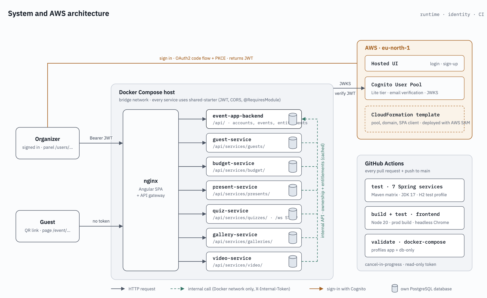
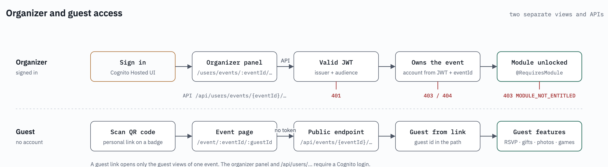
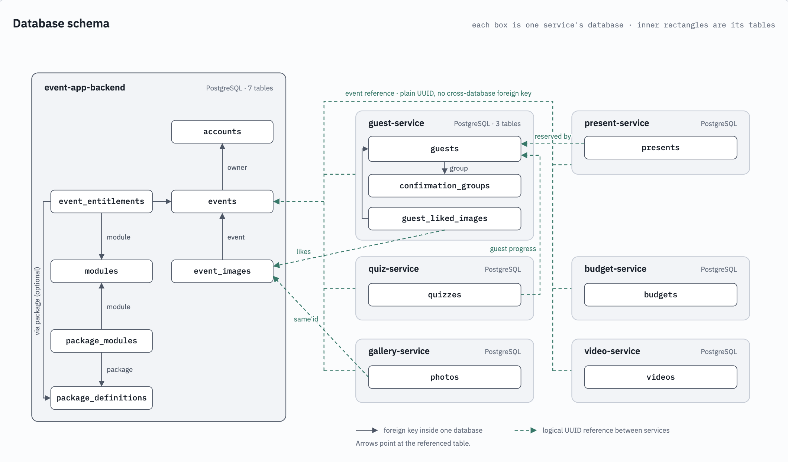

# Event App

**A multi-tenant SaaS platform for organizing events, starting with weddings.**
Organizers manage their event from one panel. Guests join from a personal QR code or link, with no account and no app to install.

> The source code is kept in a private repository because the product is being developed commercially. This repository describes the product, its architecture and the engineering decisions behind it.

---

## Table of contents

- [Features](#features)
- [Tech stack](#tech-stack)
- [Architecture](#architecture)
- [Key engineering decisions](#key-engineering-decisions)
- [Database schema](#database-schema)
- [Authentication on AWS](#authentication-on-aws)
- [CI and Docker](#ci-and-docker)
- [Testing](#testing)
- [Roadmap](#roadmap)
- [About the project](#about-the-project)

---

## Features

### For organizers (signed in)
- **Several events on one account.** Create events, switch between them, and every view is scoped to the active event.
- **Event page:** background image, location on Google Maps, welcome text, RSVP settings.
- **Guest list and confirmation groups** (couples, families). Generates **printable PDF badges with QR codes**, one per guest.
- **Budget** with planned vs. spent amounts and charts.
- **Gift registry.** Guests reserve gifts, so nobody brings the same thing twice.
- **Games:** a quiz and a "Who knows the couple better?" game, with questions written by the organizer.
- **Photo and video galleries** filled by guests during the event.
- **Packages and modules.** Each event has access to a set of modules (Basic, Premium or single add-ons). Locked modules appear as "unlock" tiles instead of disappearing.

### For guests (no login)
- Personal event page opened from a QR code or link.
- RSVP for themselves and their group.
- Gift reservation.
- Photo upload with likes, a "hall of fame", and video upload.
- Quiz and "Who knows better?" with **live results over WebSocket**.

---

## Tech stack

| Area | Technologies |
|---|---|
| Backend | Java 17, Spring Boot 3 (Web, Security, OAuth2 Resource Server, Data JPA, WebSocket/STOMP, Actuator), MapStruct, Lombok, Caffeine |
| Data | PostgreSQL 15 (one database per service), Liquibase |
| Frontend | Angular 18 (standalone APIs, signals, lazy-loaded routes), PrimeNG, PrimeFlex, Chart.js, STOMP.js, angular-auth-oidc-client, jsPDF, QR code generation, Google Maps |
| Identity | Amazon Cognito (User Pool, Hosted UI, OAuth2/OIDC), infrastructure as code with AWS CloudFormation and AWS SAM |
| Infrastructure | Docker (multi-stage builds), Docker Compose (profiles), nginx as static server and API gateway |
| CI | GitHub Actions |
| Tests | JUnit 5, Spring Boot Test, Spring Security Test, H2, AssertJ-DB, Jasmine, Karma |

---

## Architecture

The system is a set of **Spring Boot microservices**, each with its **own PostgreSQL database**, behind an **nginx gateway** that also serves the Angular single-page app.

| Service | Responsibility |
|---|---|
| `event-app-backend` | The original backend, kept after the extraction. Accounts, events, photo metadata, packages and entitlements. Source of truth for "who owns which event" and "which modules an event may use" |
| `guest-service` | Guests, confirmation groups, RSVP, photo likes |
| `budget-service` | Budget items and summary |
| `present-service` | Gift registry and reservations |
| `quiz-service` | Both games, guest progress, live results |
| `gallery-service` | Photo storage |
| `video-service` | Video storage |

**How the pieces talk**
- **Gateway routing.** nginx sends each request to the right service by its path, including the WebSocket traffic for the games. Adding a new service means adding one route.
- **REST between services, linked by UUID.** No database is shared and there are no foreign keys across databases.
- **Internal API.** Services ask `event-app-backend` who owns an event and which modules it has. This API is reachable only inside the Docker network.
- **Stateless services.** Every service validates the Cognito token on its own, so no request passes through a central auth service.

### Two kinds of access: organizer and guest

| | Organizer | Guest |
|---|---|---|
| How they get in | Sign in through Amazon Cognito | Personal QR code or link, no account |
| What they see | The organizer panel for their events | The page of the event they were invited to: RSVP, gifts, photos, videos, games |
| Access checks | Signed in, owns the event, and the event's package includes the module | Identified by their personal link |

A guest never reaches the organizer panel. A guest link opens only the guest views of one event.

---

## Key engineering decisions

### 1. Multi-tenancy: one account, many events
- An account is created automatically the first time an organizer signs in.
- One account owns many events, and every organizer view is scoped to one event.
- **The URL is not trusted.** The server checks on every request that the signed-in account owns the event. Tests cover tenant isolation: your own event works, someone else's is refused.
- After login the app opens the create form, selects the only event, or shows a picker, depending on how many events the account has.

### 2. Entitlements: selling the app as modules
- Modules (budget, gifts, quiz, guests, gallery, video) are sold in packages (Basic, Premium) or as single add-ons, each with a validity period.
- Services mark which module each feature needs, and the check is cached, so it does not cost a network call on every request.
- **Rolled out without breaking existing users:**
  1. Data model first, with nothing blocked yet.
  2. Every existing event got full access. New events get the default package.
  3. Enforcement in **log-only mode** behind a feature flag.
  4. Enforcement switched on.
- The UI shows locked modules as "unlock" tiles.
- The model is ready for payments: a future payment integration only has to grant entitlements.

### 3. A shared Spring Boot starter
A separate Maven module plugged into every service. It provides token validation, one CORS configuration and the module access checks, so every service handles security the same way. Guest features stay public, because guests never sign in.

### 4. From a monolith to microservices without downtime
The app started as a monolith plus two file-storage services. Modules were extracted with the **strangler fig** pattern and **expand → migrate → contract**. Old and new paths ran side by side until every consumer had moved.

Each extraction followed the same four steps:
1. **Decouple inside the monolith.** Remove joins, foreign keys and columns that belong to another module.
2. **New service alongside**, built from the same template, not used yet.
3. **One-off data copy with UUIDs preserved**, then the frontend switches over. The old tables stay read-only as a fallback.
4. **Cleanup**: remove the module's code and tables from the monolith once the new service has run without problems for a while.

The order **budget → presents → quizzes → guests** came from an analysis of how tightly each module was coupled to the rest. Guests went last because they were the hub of the domain, used by photos, RSVP, gifts and games. Quizzes carried the most risk because the real-time part had to move too.

### 5. Real-time games
Live scores of "Who knows better?" are pushed to every guest at once over WebSocket (STOMP).

---

## Database schema

Each box in the diagram is one service's database, and the rectangles inside it are that database's tables. Arrows inside a database are foreign keys. Links between databases are **logical UUID references** with no foreign key.

| Database | Tables |
|---|---|
| event-app-backend | `accounts`, `events`, `event_images`, `modules`, `package_definitions`, `package_modules`, `event_entitlements` |
| guest | `guests`, `confirmation_groups`, `guest_liked_images` |
| budget | `budgets` |
| present | `presents` |
| quiz | `quizzes` |
| gallery | `photos` |
| video | `videos` |

---

## Authentication on AWS

- **Amazon Cognito User Pool**: email sign-up with verification, account recovery, and the Hosted UI for login and registration.
- **OAuth2 Authorization Code flow with PKCE** from the Angular app.
- **Infrastructure as code**: the user pool and its app client are defined in CloudFormation and deployed with **AWS SAM**.
- **Low cost by design**: free up to 10,000 monthly active users, with no VPC, load balancer or NAT gateway needed.

---

## CI and Docker

- **GitHub Actions** builds and tests every service and the frontend on each pull request. Changes merge to `main` only with green checks.
- **Docker** and **Docker Compose** run the whole stack: every service with its own PostgreSQL database, and the nginx gateway.

---

## Testing

- **Backend**: controller, service and repository tests (JUnit 5, Spring Boot Test, AssertJ-DB).
- **Tenant isolation**: tests check that an organizer can reach their own events and nobody else's.
- **Frontend**: Jasmine/Karma unit tests and a production build on every PR.
- **Manual regression checklist** for the organizer and guest flows before risky releases, together with a backup and a dry run on a copy of the data.

---

## Roadmap

- Production deployment on a VPS behind **Caddy**.
- **Kahoot-style quizzes**: rework the quiz into a live game.
- **Payments**, built on the existing module model.
- **Stronger guest links**: signed links and rate limiting.
- UI redesign.

---

## About the project

Event App began as a three-person team project at **Gdańsk University of Technology**. I am now developing it into a commercial product: I designed and carried out the re-architecture, covering multi-tenant accounts, the entitlement system, the shared security starter, the step-by-step extraction into microservices, the Liquibase migration strategy, CI and the infrastructure as code.

**Mateusz Michalski** · [GitHub](https://github.com/MateuszShift)
